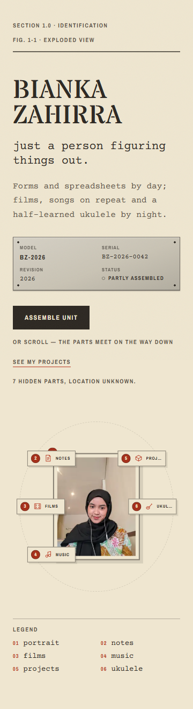
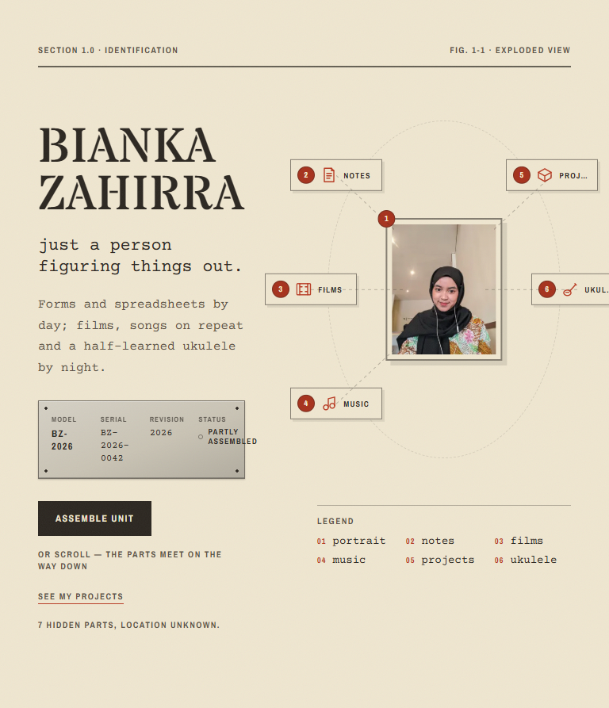
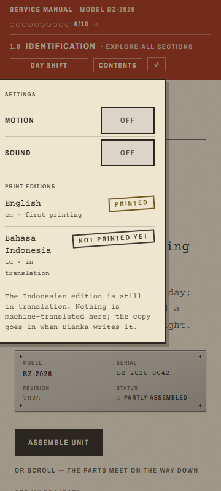
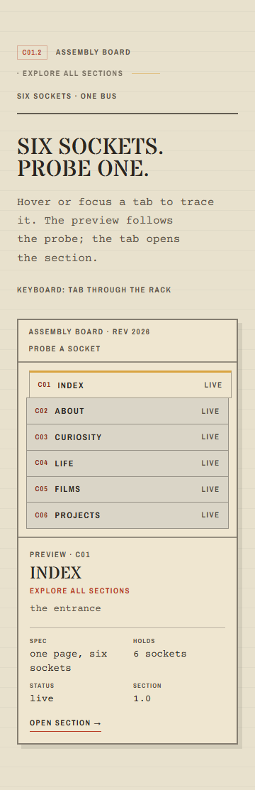
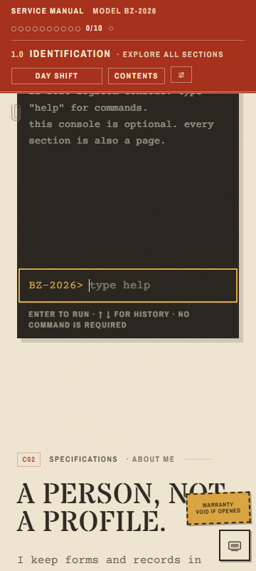
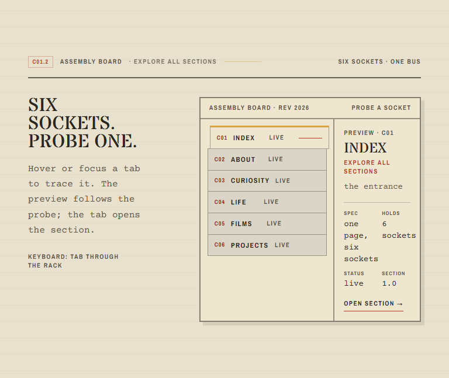

# Responsive audit — Stage R1

Scope: homepage and every section, **desktop and mobile separately**, at 360, 390,
768, 1024 and 1440px, in Day and Night shift. Then a short implementation plan for
the signature feature, Assemble (§12.4).

No site code changed in R1. This is an audit and a plan; Bianka approves both before
R2 starts.

## Method

- Production build served locally (`next build`, `next start`), headless Chrome
  driven over the DevTools protocol. Real viewport emulation, touch emulation on,
  no viewport scaling.
- Day and Night set through the same storage the site uses (`shift`); motion set to
  `reduce` so screenshots are stable. Layout is identical either way.
- Every route measured: `/`, `/about`, `/curiosity`, `/life`, `/films`, `/projects`,
  `/contact`, `/colophon`.
- Automatic checks per run: document width versus viewport, elements crossing the
  viewport edge, controls under 44px, horizontal scrollers, layout shift (CLS),
  largest contentful paint (LCP), section heights, word count.
- Interactive checks at 360: vertical swipe over the exploded diagram, Assemble,
  a socket row, the console, the settings popover, the Life film strip.
- Screenshots: `docs/audit/`. Full-page shots for 360 and 1440 in both shifts were
  produced for all eight routes (kept out of the repo to avoid 5 MB of bitmaps);
  the seven that show a finding are committed.

## Verdict

| Device | Result | Worst problem |
|---|---|---|
| Desktop 1440 | Good. Identity intact, nothing clipped. | Projects block is 2318px tall; the rest reads well. |
| Laptop 1024 | Good. Same composition as 1440. | None new. |
| Tablet 768 | **Needs work.** Desktop composition at tablet width. | Hero labels clipped; data plate wraps badly; socket preview squeezed. |
| Phone 360 / 390 | **Needs work.** Content is complete, but it is a stacked desktop, not a mobile composition. | Hero labels cover the portrait; settings card runs off-screen; band 131px tall. |

No horizontal page overflow at any width, in either shift. That part holds.

## Findings

Severity: **P1** = blocks the §12.3 goal or hides content; **P2** = friction or
polish; **P3** = note.

### P1 — Hero is desktop-shaped on phone and tablet

- At 360 the part labels sit **on top of the portrait** (PROJ…, UKUL… are cut by the
  section edge; balloon 2 covers the face area). The diagram is the identity moment,
  so this is the first thing a phone visitor sees wrong.
- At 768 the same labels are clipped mid-word at the right edge (PROJ…, UKUL…), and
  the data plate breaks: `BZ-\n2026`, `2026-\n0042`, and `PARTLY ASSEMBLED` crosses
  the plate border.
- Cause: `.exploded-part` positions are fixed `rem` offsets (`-10.5rem … 10.5rem`)
  inside a stage that is only `360px` wide on a phone; the section is
  `overflow-hidden`, so the outside halves are cut. The plate uses a 4-column grid
  from `sm:` up, too tight at 768.
- §12.3 target: stacked hero with the portrait and diagram on their own row, and no
  scroll-scrubbed assembly on touch.
- Fix in R2.1 (composition): mobile stage gets its own layout — smaller spread,
  labels below the icons on 2 lines, or labels only in the legend; plate stacks to
  2 columns until `md`. Desktop keeps today's diagram.

### P1 — Settings popover runs off the left edge at 360

- Measured: card `x = -10`, `right = 270`, viewport 360. The word SETTINGS and the
  MOTION/SOUND labels are clipped; 90px of the right side of the screen is unused.
- Cause: `absolute right-0 w-[17.5rem]` anchored to a button at x≈270.
- Fix in R2.1: position the card against the viewport on small screens
  (`fixed inset-x-4 top-[…]`, width auto) and keep the anchored card from `md` up.
- Everything else about the popover passed: focus moves in, Tab is trapped, Esc
  closes and returns focus, switches are 44px, both switches write storage.

### P1 — Mobile band takes 131px of an 800px screen

- Measured header height: **131px at 360 and 390**, 83px at 768 and up. Three rows:
  model, section line, controls.
- At 360 the controls are 23–24px tall (DAY SHIFT 128×23, CONTENTS 80×23,
  SETTINGS 30×24). The brief asks for ≥44px targets on touch. The Settings button
  has an invisible ≥44px hit area; the other two do not.
- Fix in R2.1: one row on phones — model + meter on the left, SHIFT, CONTENTS and
  SETTINGS on the right at 44px; section line moves to the page, not the band
  (it already repeats in the page header).

### P1 — Mobile assembly board is a stacked list, not a tab strip

- At 360 the board is 1113px tall (607px on desktop, +83%). Six full-width rows
  (286×38) with a large always-on preview panel below.
- Copy still says "Hover or focus a tab to trace it" and "Keyboard: tab through the
  rack" on a touch screen.
- §12.3 asks for a swipeable tab strip with native scroll-snap, tap to open, preview
  by tap/long-press or skipped.
- Fix in R2.1: keep the rack metaphor — horizontal rack at 360 with scroll-snap,
  rows → tabs, preview hidden until a tab is tapped, helper text switches to touch
  wording. Rows/tabs get ≥44px height.

### P1 — Console opens inline and hides under the band

- At 360 the console expands in the page flow (312×429 at `top: 44`), so its first
  line is under the sticky band and the page jumps.
- §12.3 asks for a bottom sheet on mobile, optional as before.
- Fix in R2.1: a bottom sheet at 640px and below (fixed, safe-area padding, Esc and
  a close button, focus moved in), inline panel from `md` up. Desktop unchanged.

### P2 — Tablet socket preview is squeezed

- At 768 the preview column is about 150px: `one page, six sockets` wraps one word
  per line, and `PREVIEW · C01` is clipped at the right edge.
- Fix in R2.1: at 768–1023 stack the preview under the rack, or give the rack a
  narrower column and the preview a minimum of 220px.

### P2 — Phone homepage is longer than desktop

- 8506px at 360 (≈10.6 screens of 800px) versus 7503px at 1440 (≈8.3 screens of
  900px). Density is 69 words per 1000px on phones versus 78 on desktop.
- Biggest mobile blocks: hero 1317, projects 1910, board 1113, notes 1072.
- Not a bug on its own; it confirms the "stacked desktop" verdict. R2.1 should cut
  the board to a strip and the hero to one diagram row.

### P2 — Decorative sticker covers body text at 360

- The fixed `WARRANTY VOID IF OPENED` sticker sits bottom-right over content; at 360
  it lands on the "A person, not a profile." heading while reading.
- Fix in R2.1: hide the fixed sticker below `md`, or dock it inside the section it
  belongs to. Easter eggs still reachable.

### P2 — Footer link rows are 21px tall

- Elsewhere rows (GitHub, Letterboxd, Spotify, Instagram) measure 21px high with
  36px pitch. Inline links in prose are fine; these are standalone list links, so
  they should be 44px on touch.
- Fix in R2.1: padding on the row, not bigger type.

### P3 — Films on the homepage is text only

- The homepage C05 section at every width is heading + link; the lamp panel lives on
  `/films`. §12.3 lists "lamp grid, tap to light" for Films. Decide in R2.1 whether
  the homepage keeps a text teaser (cheap, fast) or shows a 4-lamp strip that links
  to `/films`.

## Measurements

Homepage, motion reduced, one run per cell:

| Width | Height | Words | Words / 1000px | CLS | LCP |
|---:|---:|---:|---:|---:|---:|
| 360 | 8506 | 584 | 68.7 | 0 | 160ms |
| 390 | 8387 | 584 | 69.6 | 0 | 84ms |
| 768 | 6670 | 584 | 87.6 | 0 | 116ms |
| 1024 | 6790 | 584 | 86.0 | 0 | 144ms |
| 1440 | 7503 | 584 | 77.8 | 0 | 136ms |

Section heights, 360 versus 1440:

| Block | 360 | 1440 |
|---|---:|---:|
| Hero | 1317 | 880 |
| Lately | 243 | 134 |
| Assembly board | 1113 | 607 |
| Console | 694 | 540 |
| About | 462 | 562 |
| Projects | 1910 | 2318 |
| Notes | 1072 | 726 |
| Life | 399 | 559 |
| Films | 432 | 381 |

Other routes at 360 (height / words / overflow): `/about` 7281 / 502 / none,
`/curiosity` 3710 / 286 / none, `/life` 4495 / 285 / none, `/films` 2339 / 107 /
none, `/projects` 3667 / 232 / none, `/contact` 2810 / 136 / none, `/colophon`
3597 / 198 / none. Tablet and desktop are clean on all of them.

CLS and LCP are local, reduced-motion numbers. They are evidence that nothing
shifts when the page settles, not a field measurement; the real numbers are Stage 4.

## What passed

- Vertical swipe over the exploded diagram scrolls the page (scrollY 672 → 1044).
  `touch-action` is doing its job.
- Life film strip is native scroll-snap (`x mandatory`) and moved 289px on a swipe;
  the page did not scroll sideways.
- Assemble works by tap: stamp appears, button reads UNIT ASSEMBLED, meter 1/10.
- Every route renders in Day and Night with no horizontal overflow.
- Colophon, projects and about reflow cleanly at 360 (tables and parts lists stack).
- Settings popover keyboard behaviour is correct (focus in, Tab trapped, Esc out).

## Needs Bianka's eyes

The headless browser cannot judge print texture, stamp legibility at arm's length,
or how the diagram feels under a thumb. Two checks only a real phone can settle:

1. 360px hero: does the portrait plus labels read as one diagram, or as clutter?
2. Hold-to-assemble (R2): does 1.2s feel like a machine tightening, or like waiting?

## Assemble implementation plan (§12.4)

The signature feature already has a working base: the exploded hero, the ASSEMBLE
button, the stamp, the meter increment and the Lately strip. R2 evolves it in three
steps, each with its own gate.

### Step R2.2 — Desktop, three stages

| Stage | Today | Change |
|---|---|---|
| 1 Idle | Parts spread, scroll scrubs assembly | Keep. Button label becomes `Assemble ▸`; helper keeps "or scroll — the parts meet on the way down". |
| 2 Moving | Parts follow scroll instantly; button jumps to the end | Pressing the button adds `data-assembling`: parts glide in over 600ms with the §7.1 easing, leader lines shorten, no scroll needed. |
| 3 Snap + stamp | Stamp appears, meter +1, Lately always visible | Add the snap overshoot (≈80ms, 2–3px), then the existing stamp. Lately fades/slides in 200ms the first time only. |

- A second click during stage 2 jumps to stage 3 (interruptible).
- `prefers-reduced-motion` or motion off: button goes straight to stage 3.
- `markFound("assemble")` is already idempotent, so the meter still gains +1 once.

### Step R2.3 — Mobile, hold to assemble

- Below 768px the scroll scrub is **off**. Assembly is touch only.
- Full-width button `Hold to assemble` (≥44px) with a progress fill driven by
  `--hold` (0→1). Hint: "tap = instant · hold = slowly".
- Hold ≥ 1200ms: parts follow the fill, then stage 3. Release early: parts drift
  back over 250ms, nothing is lost, no stamp, no meter change.
- Tap shorter than 200ms: stage 3 at once (the accessible path).
- `touch-action: pan-y` on the stage; a vertical swipe never starts a hold.
- Keyboard: the button is a real `<button>`; Enter/Space behave like a tap.
- Reduced motion: tap or hold both go straight to stage 3.

### Code shape

- `lib/assemble-gesture.ts` (new, ~40 lines, no React): pure decision function
  `gesture({ heldMs, movedPx, touch })` → `"ignore" | "instant" | "hold"`, plus
  `holdProgress(elapsedMs)` clamped 0–1. Pure so it can be tested without a DOM.
- `tests/assemble-gesture.test.ts`: tap under 200ms → instant; 1200ms hold →
  complete; release at 600ms → drift back; 20px vertical move → ignore; reduced
  motion → instant. Written RED first.
- `components/exploded-hero.tsx`: pointer handlers, `matchMedia("(max-width:
  767px)")`, `data-assembling`, `data-hold`, the new labels, no scroll listener on
  phones.
- `app/globals.css`: `.exploded-stage` reserved height (no CLS), hold fill,
  overshoot keyframe, `touch-action: pan-y`. Timings from §7.1 tokens.
- No new dependency, no canvas, no 3D.

### Acceptance checks for R2.3

- Meter +1 only on first completion; replaying adds nothing.
- Stamp contrast passes AA in Day and Night.
- Stage 3 in under 1.2s from a tap; content readable within 500ms.
- CLS stays 0 on load and during assembly.
- 360, 768 and 1440, both shifts, plus keyboard and reduced motion.
- No vertical swipe trapped on the diagram.

### Risks

- Removing the scroll scrub on phones changes the hero's feel. It is what §12.3
  asks for, but it is the one behaviour change Bianka should confirm now.
- Hold timing is a feel decision: 1.2s is a starting value, to be tuned on a real
  phone before R2 closes.

## Order for R2

1. **R2.1 — mobile composition:** hero stack, band height and targets, board strip,
   console sheet, settings position, footer rows, sticker. This removes every P1
   above except the assembly behaviour.
2. **R2.2 — desktop Assemble stages.**
3. **R2.3 — mobile hold to assemble.**
4. Real-device pass after each step, per §12.5.
